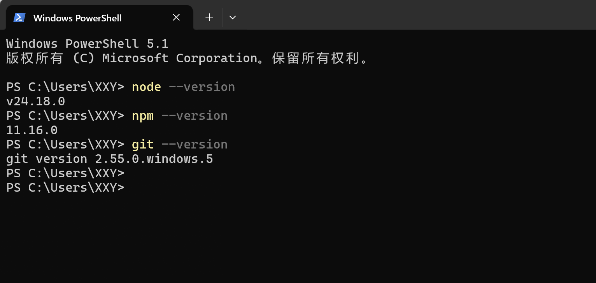
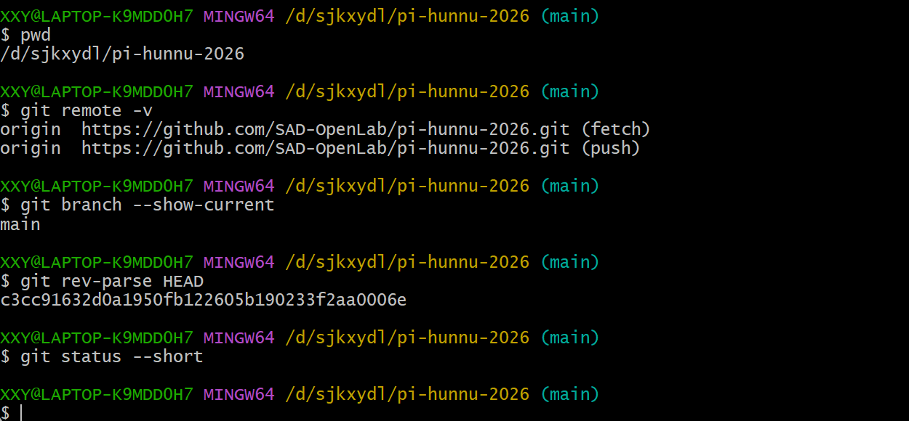
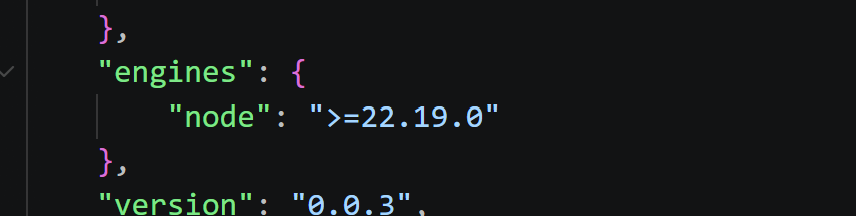
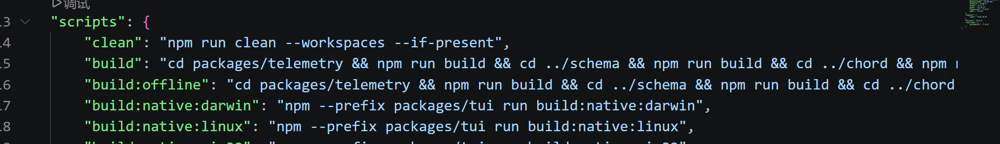
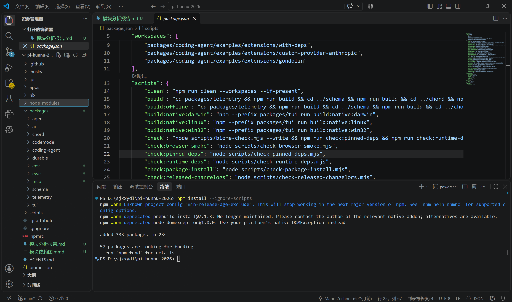
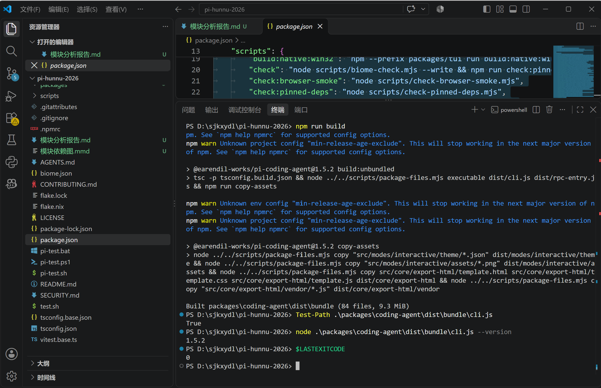
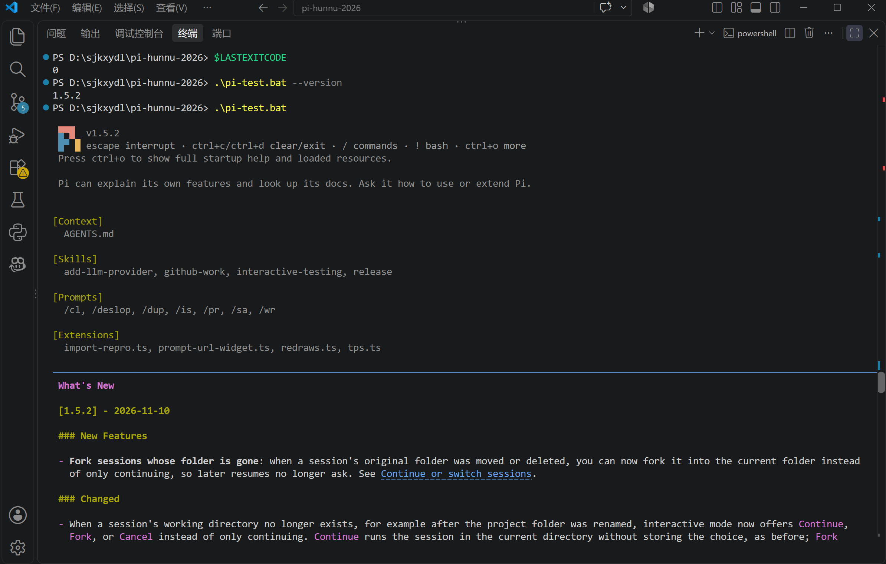
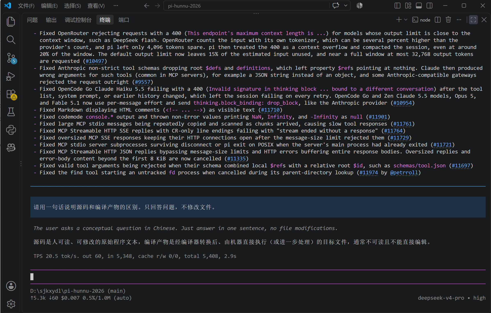

# Pi Agent 源码获取、依赖安装与本地编译实验报告

## 一、实验目标

本次实验在本地获取课程仓库源码，检查 Node.js、npm 和 Git 环境，从仓库根目录安装依赖并执行构建，最后分别验证编译产物和本地源码入口。实验重点是理解源码、依赖和构建产物之间的关系；不构建独立 EXE，也不下载大模型权重。

## 二、开发环境

本次记录的工具版本如下，版本以本机命令输出为准：

| 工具 | 版本 |
|---|---|
| Node.js | v24.18.0 |
| npm | 11.16.0 |
| Git for Windows | 2.55.0.windows.5 |



*图 S1：PowerShell 中分别运行 `node --version`、`npm --version` 和 `git --version` 的结果。*

## 三、获取源码并确认版本

本次使用第二次实践作业中小组组织内的仓库。源码已经克隆到本机，截图中的仓库目录为 `/d/sjkxyd1/pi-hunnu-2026`（Git Bash 路径），远端为 `SAD-OpenLab/pi-hunnu-2026`，当前分支为 `main`。

```text
origin  https://github.com/SAD-OpenLab/pi-hunnu-2026.git
branch  main
commit  c3cc91632d0a1950fb122605b190233f2aa0006e
```



*图 S2：通过 Git Bash 命令确认源码已经下载到本地。*

## 四、阅读项目配置

### Node.js 版本要求

版本要求写在仓库根目录 `package.json` 的 `engines` 字段中：Node.js 需为 `>=22.19.0`。本次使用的 Node.js v24.18.0 满足要求；Node.js 24 是课程建议的版本系列，不代表项目最低版本要求为 24。

### 构建命令

在仓库根目录运行 `npm run build` 时，npm 会读取根目录 `package.json` 的 `scripts.build` 字段，并执行其中定义的串联命令。该脚本依次进入 `packages` 下配置的多个子目录，调用各子包自己的 `build` 脚本。`&&` 表示前一个命令成功后才会继续执行下一个命令；每个子包的具体构建操作由其 `package.json` 中的脚本定义。

本项目使用 npm workspaces，应从仓库根目录统一安装依赖和执行构建，无需为每个子包另建锁文件。





*图 S3：Node.js 要求定义在根 `package.json` 的 `engines.node`；构建命令定义在该文件的 `scripts.build`。*

## 五、安装项目依赖

在仓库根目录运行：

```powershell
npm install --ignore-scripts
```

该命令根据根 `package.json` 和 `package-lock.json` 安装当前项目及工作区所需依赖，并在项目中准备 `node_modules` 等目录。这里没有使用 `-g`，所以这是项目本地依赖安装，不会把修改后的源码安装成全局 `pi` 命令。`--ignore-scripts` 跳过安装期间自动触发的生命周期脚本；之后手动运行 `npm run build` 仍会执行构建脚本。

截图中的安装输出显示新增了 333 个包，并返回到 PowerShell 提示符。日志同时出现 `min-release-age-exclude` 配置提示和两个依赖弃用提示。这些提示不等同于安装失败；截图没有显示明确的 `$LASTEXITCODE`，因此报告不据此声称安装退出码为 0。截图也没有展示完整的 `npm audit` 汇总，故不推断漏洞数量。



*图 S4：安装过程显示 `added 333 packages in 23s`。*

## 六、本地构建与产物验证

在仓库根目录运行：

```powershell
npm run build
```

该命令读取根 `package.json` 中的 `scripts.build`，再按照脚本顺序调用工作区构建命令。首次构建可能联网获取模型目录等配置数据；这里的模型目录数据不是大模型权重，构建客户端也不等于启动模型推理服务。如果获取模型目录遇阻，可先运行 `npm run hydrate:model-data` 准备数据，再运行 `npm run build:offline`。

截图记录的构建输出包含 `packages\coding-agent\dist\bundle` 的构建结果。随后检查产物并运行其版本命令：

```powershell
Test-Path .\packages\coding-agent\dist\bundle\cli.js
node .\packages\coding-agent\dist\bundle\cli.js --version
$LASTEXITCODE
```

截图中 `Test-Path` 输出 `True`，本地 bundle CLI 输出版本 `1.5.2`，`$LASTEXITCODE` 输出 `0`。这验证了截图对应构建产物存在且可以由 Node.js 启动。构建产物位于 `dist`；后续开发应修改 `src` 中的源码并重新构建，不应直接编辑 `dist` 文件。



*图 S5：显示构建产物、`Test-Path` 检查、CLI 版本 `1.5.2` 和退出码 `0`。*

首次构建成功且所需模型目录数据仍有效后，可按项目脚本使用 `npm run build:offline` 重新构建；它复用已有数据，不是首次初始化数据的替代命令。

## 七、启动本地源码并验证会话

运行本地源码入口并查看版本：

```powershell
.\pi-test.bat --version
```

截图显示该入口输出 `1.5.2`。随后启动交互界面：

```powershell
.\pi-test.bat
```

此入口通过仓库提供的脚本运行本地源码，不依赖直接输入 `pi`（后者可能启动此前安装的全局版本）。实验中向 Pi 提问“请用一句话说明源码和编译产物的区别。只回答问题，不修改文件。”，并收到了一句中文回复，证明本地源码程序启动后完成了交互。





*图 S6：先用 `.\pi-test.bat` 确认运行仓库提供的本地源码入口，再进行一次实际会话。*

### 源码入口

例如 `.\pi-test.bat`（它会运行 `packages/coding-agent/src/cli.ts`）。源码入口适合开发和调试：修改代码或排查问题时，可以直接运行当前工作区的源码，不必先重新打包；也便于结合调试工具查看和调试源码。

### 编译产物入口

例如 `node .\packages\coding-agent\dist\bundle\cli.js`。编译产物入口适合验证构建结果或运行已构建版本。它是由源码经过项目构建流程生成的可执行入口；是否适用于生产部署，应以项目的发布和部署要求为准，不能仅凭“已打包”推断体积更小、启动更快或不需要开发依赖。

使用 `.\pi-test.bat` 可明确运行本地源码；直接输入全局 `pi` 可能启动其他位置安装的版本。

## 八、遇到的问题与处理

**构建时获取模型目录遇阻。** 首次构建输出 `Fetching models.dev catalog...`，模型目录数据未能及时准备好。直接尝试离线构建也需要本地已有这份数据，因此先运行 `npm run hydrate:model-data` 水合（准备）模型目录数据，再运行 `npm run build:offline`，最终完成离线构建。这里的模型目录是配置数据，不是大模型权重。


## 九、实验结论

本次源码位于本机克隆的 `pi-hunnu-2026` 仓库，依赖由仓库根目录的 npm workspace 安装，构建命令由根 `package.json` 的 `scripts.build` 驱动。构建产物检查结果为存在，版本为 `1.5.2`，命令退出码为 `0`；源码入口 `.\pi-test.bat` 也成功启动并完成了一次模型交互。由此可分别说明源码所在位置、依赖安装范围、构建脚本来源，以及正在运行的源码/构建版本。

